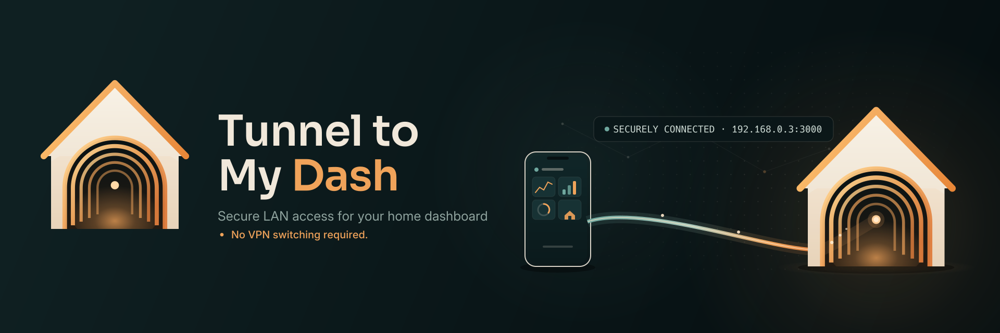

  

# Tunnel to My Dash

Open your home dashboard from anywhere without switching off your VPN.

Tunnel to My Dash is a desktop app that runs a WireGuard tunnel inside the
application and uses that tunnel for one thing: browsing your local network.
It does not create a system VPN, ask for root, or change your routing table.
Your normal VPN keeps running.

Status: early development. The Linux AppImage builds and runs: first-run
setup, encrypted vault, profiles, the dashboard window and portable data.
Mobile and Windows are next.

## Why

If your dashboard, Jellyfin, or a dev container lives on your home LAN, the
usual routine is to disconnect the VPN, bring up WireGuard, do the thing, and
switch back. It is tedious and easy to get wrong.

This app makes the tunnel part of the app. Open it, and it connects to your
home endpoint and loads the dashboard. Close it and the tunnel is gone. Only
the app's own traffic uses the tunnel.

## How it works

- A small Go core runs a userspace WireGuard device and a TCP/IP stack, so no
  root or system VPN slot is needed.
- A localhost HTTP proxy feeds the app's browser view through that tunnel.
- The browser view is Chromium (via Electron), with a small floating glass
  toolbar and in-place navigation. Auto-hide shrinks it to a centered peek
  pill that overlays the dashboard; hovering expands it with a short
  animation. Turn auto-hide off and the bar becomes a plain full-width row
  above the view. By default it can only reach private addresses; public pages
  are blocked.
- Secrets live in an encrypted vault. The app lock is optional; the same
  password unlocks the vault.
- Saved dashboard logins stay in the vault. After a successful sign-in (when
  the page navigates), the app offers to save the login; a key button in the
  toolbar copies it later without showing it to the page. The clipboard
  clears after 30 seconds. There is no autofill.
- LAN-only by default. A per-profile external-content switch can allow all
  public origins or an exact origin list for fonts and widgets; those use the
  normal network or VPN, never the tunnel.
- The active profile is checked once at startup. Click its status dot to
  re-check; green is reachable, red is not.
- The last dashboard can open automatically after launch and after every
  unlock. Behavior settings live in `settings.json`; security policy lives in
  the vault.
- The dashboard toolbar has a Main menu button and a labeled Lock button with a
  blurred snapshot behind the lock card. The window X quits the app; Main menu
  returns to the main menu. Back to main menu from the lock overlay also lands
  on the main menu after unlocking.

More detail in [docs/DESIGN.md](docs/DESIGN.md).

## Principles

- No telemetry, analytics, accounts or cloud.
- No system VPN, root or firewall changes.
- Strict LAN-only by default; fail closed.
- WireGuard keys never stored in plaintext.
- Linux first; Android and Windows later.

## Layout

    core/       Go tunnel, proxy, vault and CLI
    desktop/    Electron shell and UI
    docs/       design, roadmap, plan and security notes
    scripts/    build and toolchain helpers

## Run it

From a checkout:

    make core
    make desktop-deps
    make desktop-start

The first run asks for a WireGuard `.conf`, a dashboard URL such as
`http://192.168.0.3:3000`, and an optional app password. During development the
vault, Electron profile and core data live under `local/dev-data`, which is
ignored by git.

## Run the AppImage

Build it with `make appimage`, or use the artifact in `desktop/release`:

    chmod +x desktop/release/Tunnel-to-My-Dash-*.AppImage
    ./desktop/release/Tunnel-to-My-Dash-*.AppImage

The app creates `tunnel-to-my-dash-data/` beside the AppImage and keeps the
vault, the Chromium profile and the core socket there. Move the AppImage and
that folder together. If the folder is not writable, it falls back to the
normal per-user data directory.

`make release` builds the AppImage and writes `SHA256SUMS` next to it. Updates
are manual and telemetry-free: download a newer AppImage and replace the old
one. The app does not phone home for updates.

## Current limits

- LAN-only by default. External content is opt-in per profile: all public
  origins, or an exact-origin list; wildcards are not supported.
- The dashboard opens in its own window with a toolbar; links stay in the same
  view. A same-window/new-window setting is planned.
- Auto-hide can be turned off in Settings if you prefer the floating toolbar
  always visible.
- Launch at login, start minimized and close to tray are deferred until the
  tray icon exists.
- Windows and Android packaging come after the Linux AppImage.
- Jellyfin playback inside the app is still untested; Jellyfin, OpenCode and
  the laptop dashboard answered over HTTP through the tunnel.
- Release artifacts have SHA-256 checksums; GPG signing will follow when a
  release key exists.

## Development

Requirements: Linux, Node.js 24+ and Go. The Go toolchain is downloaded into
`.tools/` (gitignored) so the build does not depend on a system install.
Electron and npm dependencies stay in `desktop/node_modules` and `.cache/`.

Build caches and temporary files stay inside the project:

    make help
    make env
    make desktop-deps
    make desktop-check
    make desktop-start
    make appimage
    make release
    make clean

Never commit a real WireGuard config or vault. Put local test files in
`local/`, which is ignored.

Ideas and deferred work live in [docs/BACKLOG.md](docs/BACKLOG.md).

## License

GPL-3.0. See [LICENSE](LICENSE).
